# Logbook Instance Segmentation

**Nama:** Nazhif Berlian Nashrullah  
**NRP:** 5054241035

## 1. Dataset Train & Val

Penggunaan dataset [Panoptic Indoor Segmentation dari Roboflow](https://universe.roboflow.com/panopticindoor/panoptic-indoor-segmentation) sebagai data training dan data validation.

## 2. Dataset Test

Untuk dataset test saya menggunakan 40 foto yang saya ambil dari HP pribadi. Ada yang baru saya potret dan ada juga foto lama yang ada di galeri. Kriteria foto yang saya gunakan adalah foto dengan objek yang banyak dan bertumpuk, pencahayaan yang kurang, serta sudut yang ambigu.

Dataset test memiliki **42 kelas**, **3.739 anotasi**, dan **median 70,5 objek per foto**. Foto yang paling padat memiliki **410 objek**.

## 3. Anotasi

Anotasi dilakukan menggunakan Roboflow Instance Segmentation. Anotasi dibuat secara manual dengan *polygon tool*, dibantu fitur **Find Objects with AI Model SAM 3** milik Roboflow untuk kelas yang besar dan banyak.

## 4. Model

Untuk memenuhi persyaratan tugas, saya menggunakan empat model berikut.

1. **YOLO11n-seg pretrained**
   - Model: `yolo11n-seg.pt`.
   - Training: maksimal 100 epoch, batch 4, ukuran gambar 960 px, seed 42.
   - Optimasi: AdamW, `lr0=0.001`, `lrf=0.01`, cosine learning rate, warmup 3 epoch, weight decay `0.0005`.
   - Penghentian: early stopping `patience=25`.
   - Augmentasi: HSV `(0.015, 0.4, 0.3)`, rotasi 5°, translasi 0,1, skala 0,3, horizontal flip 0,5, mosaic 0,5, ditutup pada 15 epoch terakhir.
   - Mask dan memori: `mask_ratio=2`, mixed precision aktif, cache disk.

2. **YOLO11n-seg from scratch**
   - Model: `yolo11n-seg.yaml`, bobot awal acak.
   - Training: maksimal 100 epoch, batch 4, ukuran gambar 960 px, seed 42.
   - Optimasi: AdamW, `lr0=0.001`, `lrf=0.01`, cosine learning rate, warmup 3 epoch, weight decay `0.0005`.
   - Penghentian: early stopping `patience=25`.
   - Augmentasi: HSV `(0.015, 0.4, 0.3)`, rotasi 5°, translasi 0,1, skala 0,3, horizontal flip 0,5, mosaic 0,5, ditutup pada 15 epoch terakhir.
   - Mask dan memori: `mask_ratio=2`, mixed precision aktif, cache disk.

3. **YOLOv8n-seg pretrained (CNN)**
   - Model: `yolov8n-seg.pt`.
   - Training: maksimal 100 epoch, batch 4, ukuran gambar 960 px, seed 42.
   - Optimasi: AdamW, `lr0=0.001`, `lrf=0.01`, cosine learning rate, warmup 3 epoch, weight decay `0.0005`.
   - Penghentian: early stopping `patience=25`.
   - Augmentasi: HSV `(0.015, 0.4, 0.3)`, rotasi 5°, translasi 0,1, skala 0,3, horizontal flip 0,5, mosaic 0,5, ditutup pada 15 epoch terakhir.
   - Mask dan memori: `mask_ratio=2`, mixed precision aktif, cache disk.

4. **RF-DETR Seg Nano pretrained (transformer)**
   - Model: `RFDETRSegNano`, resolusi 480 px.
   - Training: maksimal 60 epoch, batch 2, batch evaluasi 1, seed 42.
   - Optimasi: learning rate `1e-4`, akumulasi gradien 4 langkah.
   - Penghentian: early stopping `patience=15`.
   - Memori: mixed precision otomatis, maksimal 2 worker, `prefetch_factor=1`.

## 5. Eksperimen NRP

Membandingkan model YOLO11 menggunakan bobot pretrained dan tanpa bobot pretrained.

## 6. Hipotesis

Hipotesis saya, YOLO11n pretrained akan unggul pada objek kecil dan bentuk yang jelas seperti kelas `bottle`, `pan`, dan `spoon` karena input 960 piksel, fitur multiskala, dan bobot awal pretrained. RF-DETR berpotensi lebih baik pada objek yang membutuhkan konteks luas atau mask dengan bagian terpisah karena memakai transformer dan anotasi COCO langsung.

## 7. Analisis Kegagalan Berbasis Bukti

### IMG_5121

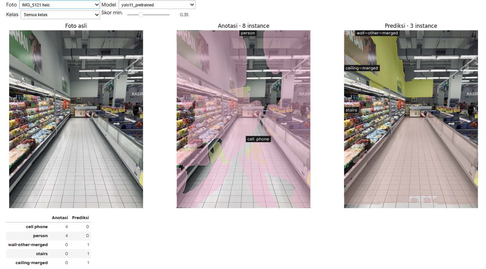

Tabel menghitung **318 anotasi**, tetapi visualisasi 640 px menampilkan **8**. Periksa berapa mask kecil yang hilang ketika ditampilkan. Jadi, selisih 318 anotasi lawan 11 prediksi tidak boleh langsung dijelaskan seluruhnya sebagai kegagalan arsitektur.

### IMG_3368

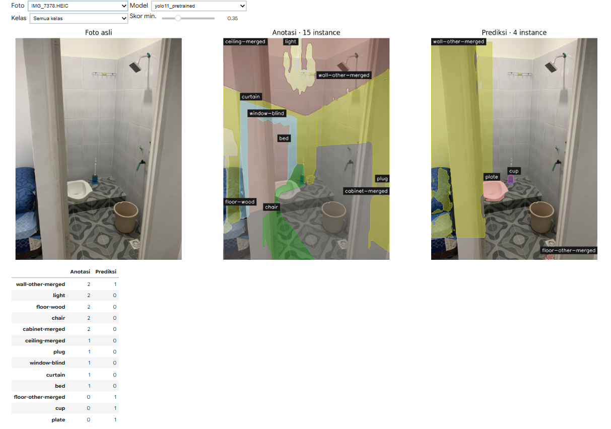

Tidak ada prediksi pada confidence 0,35. Pencahayaan dan tampilan lokasi berbeda jauh dari foto ruangan biasa. Uji apakah prediksi muncul pada ambang 0,05 untuk membedakan skor rendah dari tidak adanya deteksi.

### IMG_7326 dan IMG_7324

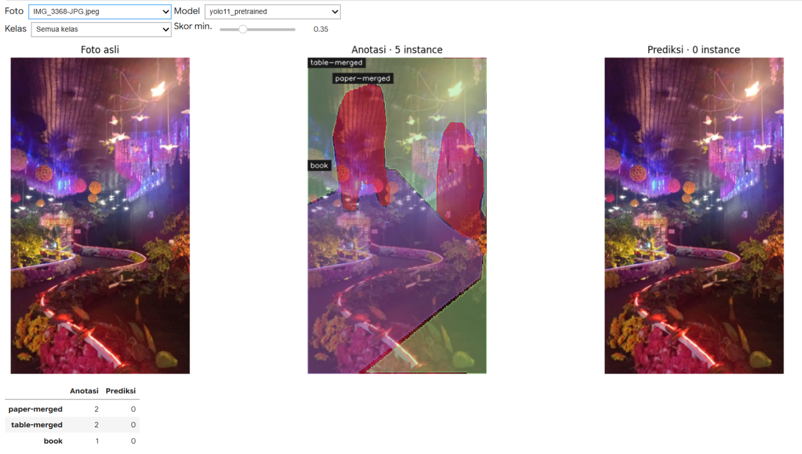

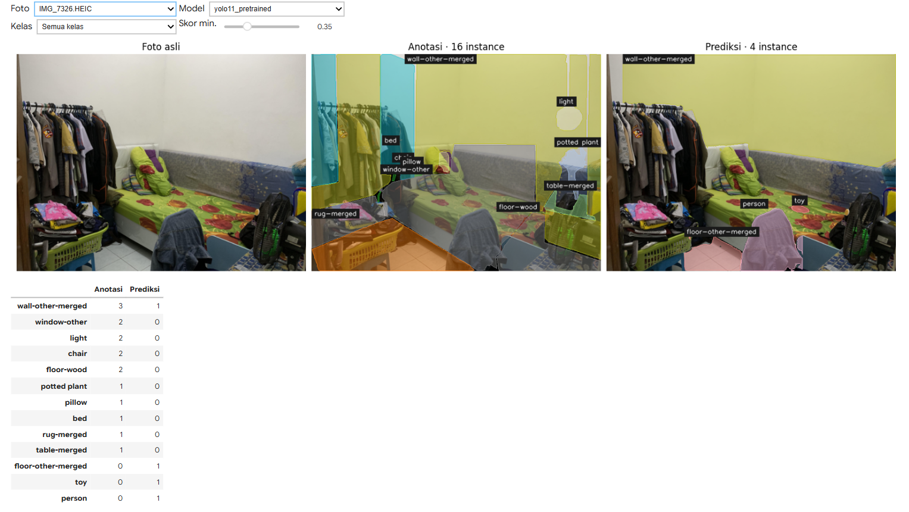

Area besar seperti dinding masih terdeteksi, sedangkan banyak objek kecil terlewat atau salah kelas. Ini konsisten dengan hilangnya detail spasial dan kebingungan kelas yang tampilannya mirip, tetapi perlu dicek lewat ukuran mask dan skor prediksi.

### IMG_7378

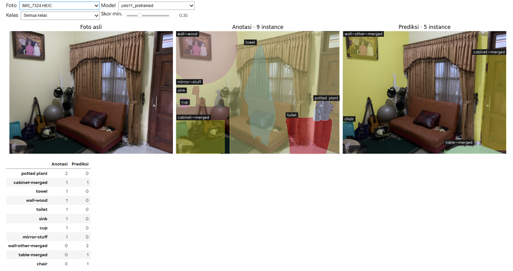

Prediksi `plate` dan `cup` muncul di area kamar mandi. Selain salah klasifikasi, beberapa label anotasi pada gambar yang ditunjukkan tampak perlu diperiksa, misalnya `bed` di kamar mandi dan `toilet` pada foto ruang duduk. Label yang keliru juga menurunkan skor evaluasi.

## 8. Hasil Eksperimen Pembuktian

| Foto | Anotasi asli | Mask kecil pada 960 px | Mask terlihat pada 640 px | Prediksi skor ≥0,05 | Prediksi skor ≥0,35 |
|---|---:|---:|---:|---:|---:|
| IMG_5121 | 318 | 70 | 298 | 98 | 11 |
| IMG_7378 | 38 | 10 | 33 | 100 | 9 |
| IMG_3368 | 92 | 10 | 91 | 100 | 11 |
| IMG_7326 | 36 | 9 | 32 | 100 | 7 |
| IMG_7324 | 9 | 0 | 9 | 100 | 12 |

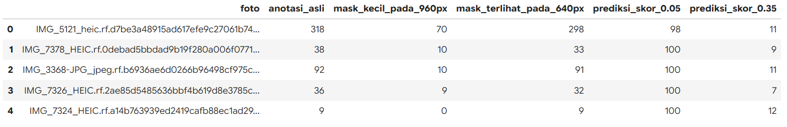

Nama fotonya cocok, dan pemeriksaan ID tidak gagal. Angkanya menunjukkan banyak prediksi turun setelah ambang skor dinaikkan dari 0,05 ke 0,35. Namun, visualisasi sebelumnya belum aman dipakai sebagai bukti. Untuk IMG_5121, tabel ini mencatat **318 anotasi dan 298 mask masih terlihat pada 640 px**, sedangkan gambar visualisasi menulis hanya **8 anotasi**. Ini menunjukkan sel visualisasi kemungkinan masih membaca variabel global `ground_truth` yang telah mengarah ke Panoptic.

## 9. Bukti Proses

| Tanggal | Kegiatan | Gambar |
|---|---|---|
| 11 November 2026 | Membaca Data Panoptic | 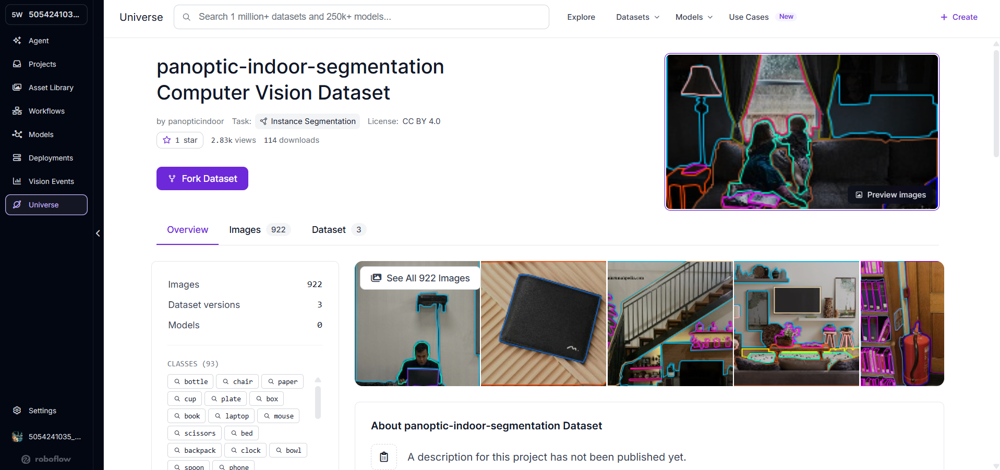 |
| 11 November 2026 | Belajar Anotasi Menggunakan Roboflow | 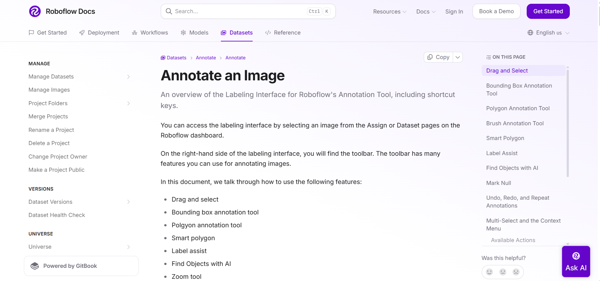 |
| 12 November 2026 | Research model yang ingin digunakan: YOLO11n-seg pretrained; YOLO11n-seg from scratch; YOLOv8n-seg pretrained (CNN); RF-DETR Seg Nano pretrained (transformer). | 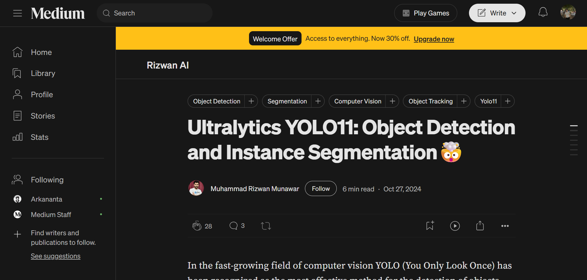 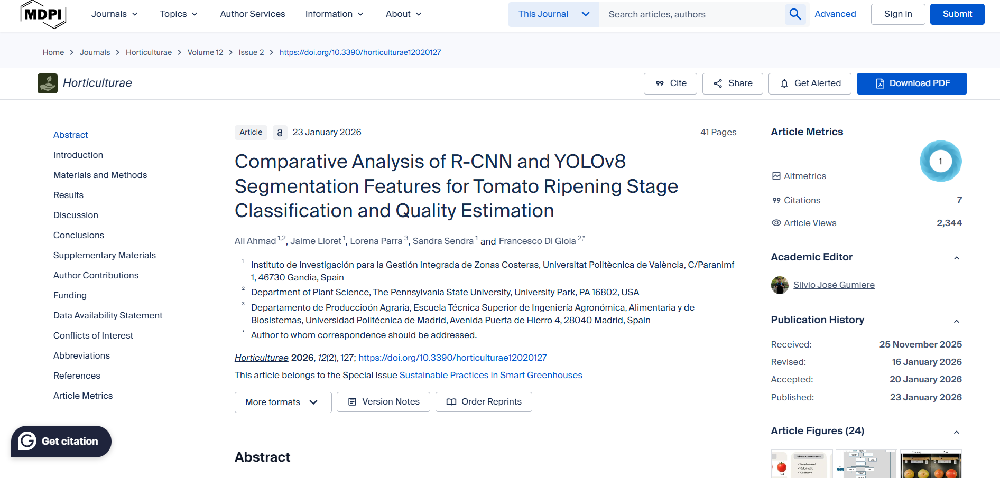 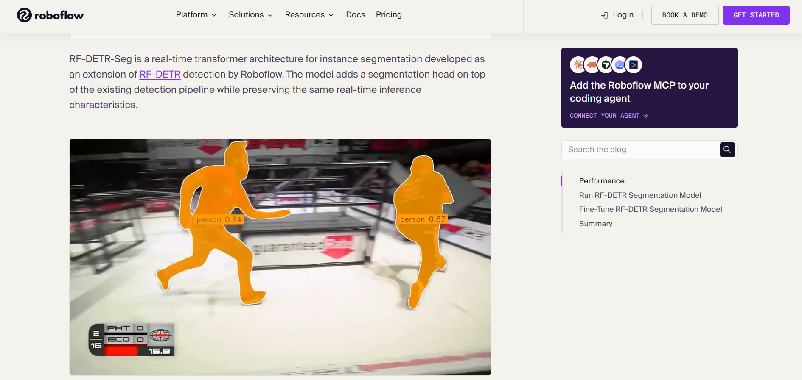 |
| 12–17 November 2026 | Mengambil 40 foto untuk dataset tes | 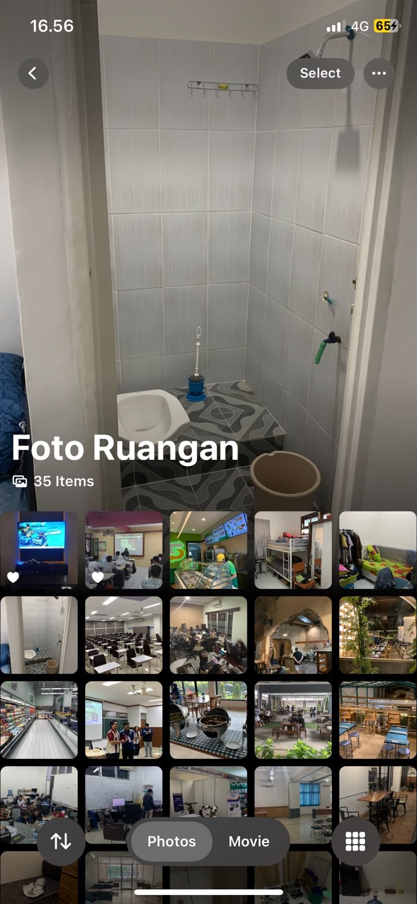 |
| 14 November 2026 | Anotasi di Roboflow | 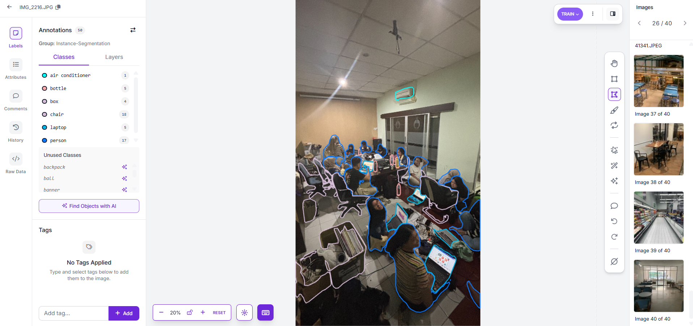 |
| 17 November 2026 | Anotasi di Roboflow | 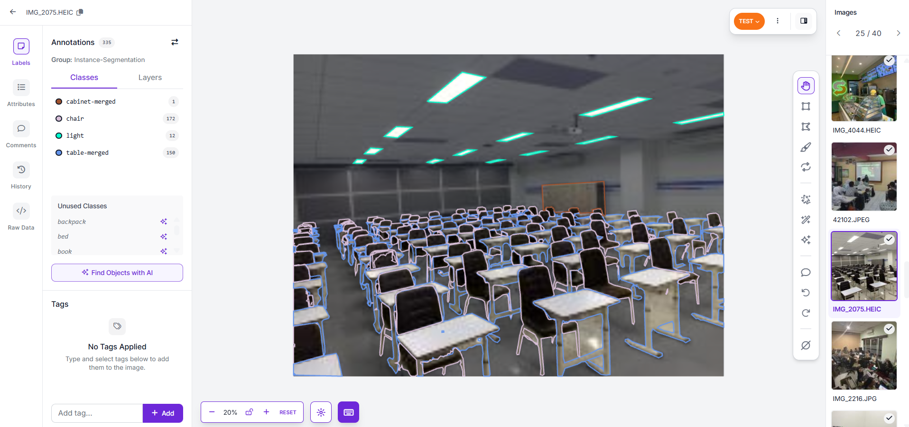 |
| 18 November 2026 | Anotasi di Roboflow | 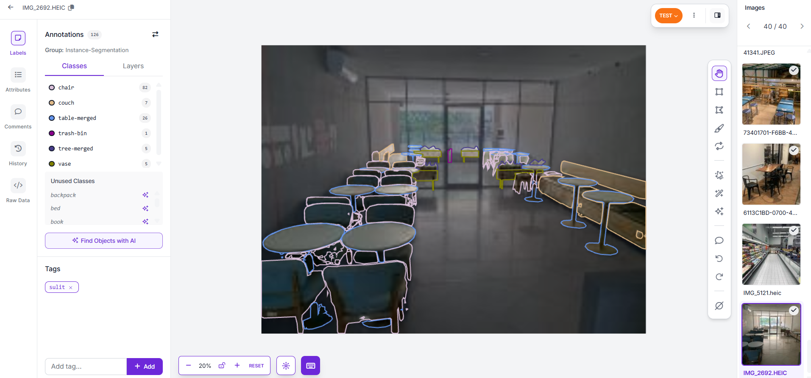 |
| 22 November 2026 | Anotasi di Roboflow | 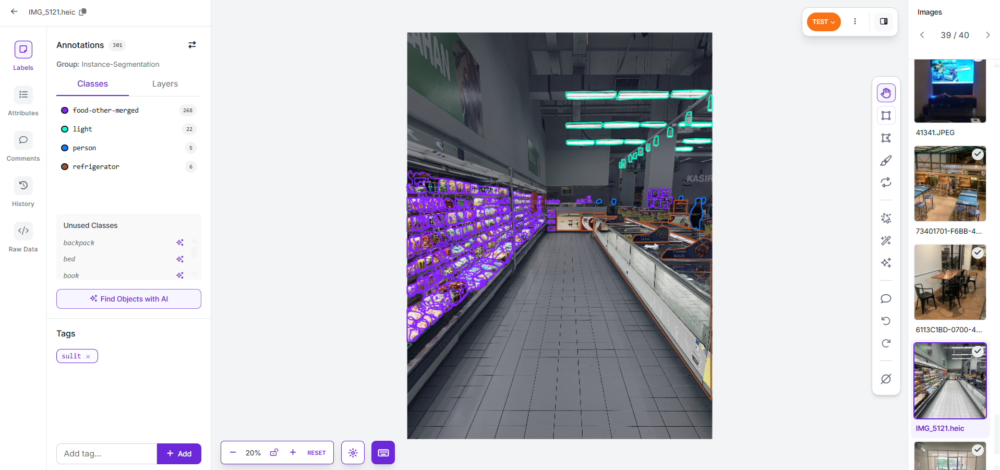 |
| 23 November 2026 | Training YOLO pretrained dan YOLO scratch | 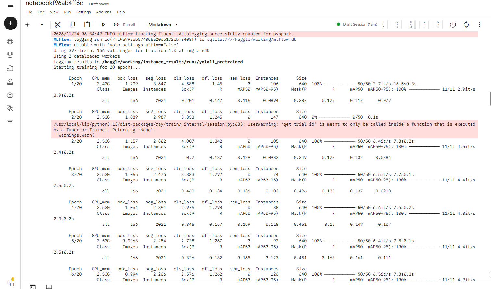 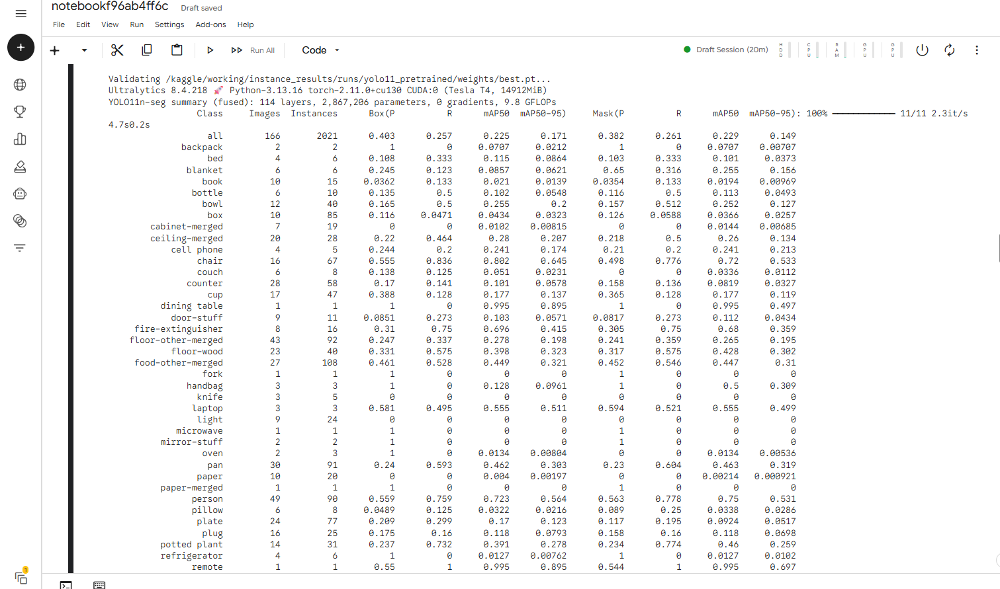 |
| 24 November 2026 | Final Annotation dan Training Model dengan 40 Data Test | 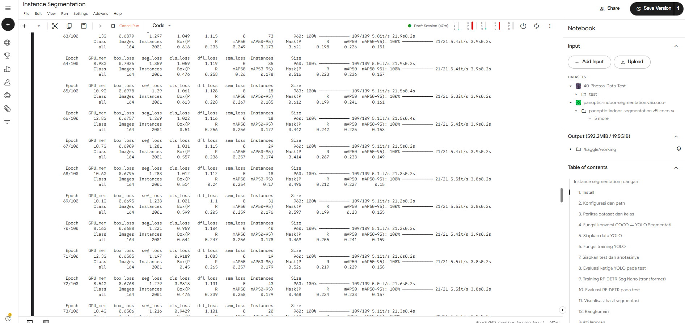 |

## 10. AI Used

- Anotasi 40 gambar: “find table”.
- Verifikasi notebook: “Recheck the Correct Code and Method in Instance Segmentation Notebook”.
- Membantu menganalisis hasil segmentasi: “Why the YOLO11 better to recognize oven and YOLO8 better to recognize door-stuff”.

## 11. Link Relevan

- [Kaggle Notebook: Instance Segmentation](https://www.kaggle.com/code/nazhifberlian/instance-segmentation)
